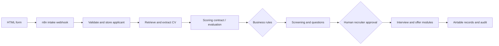

# From Application to Hire | Group 8 AI Recruitment Orchestrator

**TechCrush AI Automation Capstone | Group 8 collaborative project**  
**Team lead: Grace Omolola Odukoya**

Grace coordinated project architecture, work allocation, initial application intake, and integration across the team. **She independently created all 50 synthetic candidate profiles and their PDF CV test data.** Group 8 teammates contributed modules including CV processing, scoring, screening, recruiter decisions, scheduling, and the Python question generator.

## The problem

Recruiters often move between forms, CV folders, spreadsheets, calendars and email to complete one hiring journey. The handoffs create duplication and unclear ownership. Group 8 designed a modular n8n recruitment orchestration prototype to make each stage explicit while keeping consequential decisions under human oversight.

## What the team built

- Application intake via webhook, candidate splitting, required-field validation, and Airtable upsert.
- CV download and PDF extraction components.
- Job requirements retrieval, structured scoring contracts and business-rule routing.
- Screening questions and analysis modules, with a Python/LangChain/Gemini generator contributed by the team.
- Recruiter approval, offer and interview-scheduling workflow modules.
- Candidate state transitions and audit-oriented structures.
- A fully fictional [50-CV test dataset](https://github.com/graceomolola001-cmyk/group-8-recruitment-test-data), created independently by Grace.

## Evidence boundaries

**The capstone was a modular proof of concept.** The main exported batch evaluation relied on a labelled JavaScript mock in the documented demonstration. A configured Gemini node, pinned screening outcomes or exported downstream modules do **not** prove live AI assessment or an end-to-end hire. Recruiter write-back, parent-to-child handoffs and some state transitions require verification.

## Replicate safely

1. Create a test Airtable base with `Candidates`, `Jobs`, `Screening`, `Interviews`, `Offers` and `Audit` tables as relevant to each module.
2. Import the sanitized n8n exports from `workflows/` **one at a time** and reconnect credentials privately.
3. Start with one fictional `CAP26-` candidate from the linked test dataset.
4. Test webhook validation, CV retrieval, extraction and the Airtable candidate write.
5. Confirm any simulated scores are marked **mock**. Enable model calls only when configured and independently tested.
6. Add screening and recruiter approvals with a verified audit trail before testing interview and offer progression.
7. Test missing CV URLs, missing jobs, invalid states, duplicate applications and approval rejections.

## Architecture

The stages above represent the designed system, including partially integrated modules.

## Project sources

- [Team capstone artifacts in Google Drive](https://drive.google.com/drive/folders/1SirXxtXzJOiOH5pcO_K0COzGttZO66Ro)
- [Grace's 50 synthetic candidate CVs](https://github.com/graceomolola001-cmyk/group-8-recruitment-test-data)
- [Group 8 visual system blueprint](https://drive.google.com/file/d/1ShBErSUq1lbaNg8NlREmMeU2kMmb3Rqf/view)

**Responsible-use warning:** This is an educational prototype, not a validated hiring decision engine. Do not use automated candidate recommendations for consequential employment decisions without human oversight, fairness evaluation and privacy controls.
