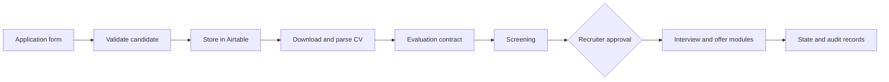

# From Application to Hire: An AI-Assisted Recruitment Pipeline

**TechCrush AI Automation Capstone · Group 8 · n8n · Airtable · JavaScript · Python · Gemini**

**Team lead: Grace Omolola Odukoya**

## The challenge

Imagine receiving 50 applications for one role. Someone has to collect the CVs, review relevant experience, compare each person with the job requirements, organize screening, and coordinate interview and offer decisions.

Now spread those steps across a form, an inbox, a spreadsheet, an ATS-like database, and a calendar. Every handoff takes attention.

Our Group 8 capstone explored how a modular automation system could make those handoffs easier to follow, while leaving hiring decisions with people.

## What we built

| Module | Job in the hiring journey | Tools / approach |
| --- | --- | --- |
| **Application intake** | Receive applications, check required fields, and create or update candidate records | n8n webhook, JavaScript, Airtable |
| **CV processing** | Download PDFs, extract readable text, and prepare candidate context | n8n HTTP/PDF nodes |
| **Role matching** | Compare candidate details with role requirements using a structured scoring contract | Live AI evaluation was part of the intended design; a JavaScript mock was used for demonstration when API limits prevented live model testing |
| **Screening** | Prepare questions and record screening information | n8n; team-contributed Python, LangChain, Pydantic, Gemini module |
| **Human review** | Route shortlists and decisions for recruiter approval | Airtable, n8n |
| **Interviews and offers** | Coordinate scheduling, reminders, and offer approval as separate modules | Google Calendar, Gmail, n8n |

**Why we used a mock:** API limits prevented the team from using the intended live AI node during the demonstration. To test and show the surrounding recruitment workflow, we temporarily used a JavaScript mock that returned simulated evaluation data. The AI stage was intended to be connected for live execution once API access permitted it.

**Scope:** This was a modular proof of concept. Several components were demonstrated with synthetic records. The exports do not establish that the full application-to-hire journey ran successfully end to end.

## My contribution

As team lead, **I coordinated the architecture and responsibilities, built the initial application intake, and worked on integrating the modules.**

I also **independently created all 50 synthetic candidate profiles and their PDF CVs**. That dataset gave the team fictional applicants to use during development and testing without exposing real candidate information.

The broader capstone was collaborative. Other Group 8 members contributed workflow modules and the Python question generator. See [team credits and evidence](TEAM_AND_EVIDENCE.md).

## How the system is designed

The diagram describes the **intended modular pipeline**. It is not a claim of verified integration across every stage.

## Explore the implementation

- **[Main 22-node orchestration export](workflows/03-capstone-project.json):** Intake, CV handling, job context, and a **temporary JavaScript mock used when API limits blocked live AI testing**
- **[All ten n8n exports](workflows/):** Supporting intake, CV extraction, human review, interview, reminder, and offer modules
- **[Python screening-question generator](python-screening-generator/):** Team-contributed code and setup instructions
- **[50 synthetic CVs](https://github.com/graceomolola001-cmyk/group-8-recruitment-test-data):** Dataset created independently by Grace
- **[Workflow map](docs/WORKFLOW_MAP.md):** How the modules relate
- **[Replication checklist](docs/REPLICATION_CHECKLIST.md):** Suggested test sequence
- **[Review and known issues](docs/REVIEW_AND_TEST_RESULTS.md):** Verified findings and outstanding integration work

## Run a controlled test

1. Set up a **test** n8n instance and fictional Airtable base. Keep imported workflows inactive.
2. Import the [main workflow](workflows/03-capstone-project.json). Reconfigure Airtable table IDs, credentials, and any child workflow references.
3. Start with a single fictional candidate, using the [sample payload](examples/sample-intake.json). Check its required fields and replace the sample CV URL with a verified file URL.
4. Inspect candidate validation, CV retrieval, text extraction, and Airtable writes.
5. Treat the main evaluator's JavaScript result as a **mock**. Configure and verify model calls separately before claiming AI inference.
6. Test recruiter approval and rejection, then interview and offer modules with all external notifications disabled or redirected to a test inbox.
7. Repeat with the [missing-CV test](examples/invalid-missing-resume.json) and duplicate submissions.

**Known caveats:** The earlier `02-` intake export has disconnected wiring. Some module-to-module handoffs remain unverified. The legacy offer-approval notification routing was corrected in GitHub but has not yet passed a live execution test. See the [review](docs/REVIEW_AND_TEST_RESULTS.md).

## What this project demonstrates

This capstone shows collaborative automation architecture, workflow orchestration, API integrations, synthetic test-data design, and human-in-the-loop decisions.

The recruitment system is an **educational prototype**. It must undergo integration testing, fairness evaluation, privacy review, and human oversight before any use involving real hiring decisions.
